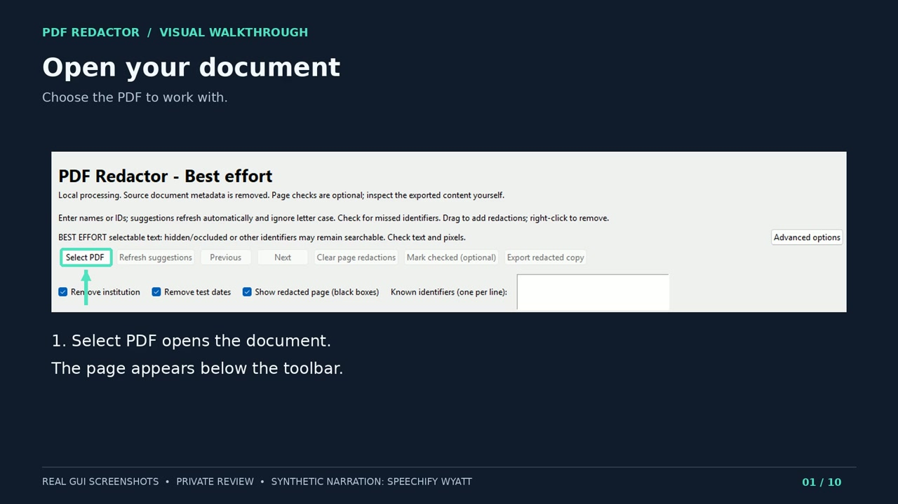

# PDF Redactor Best Effort 0.9.2

A Windows desktop app for removing selected information from PDFs. Open a document, adjust the suggested redaction boxes, and export a separate copy with selectable text or image-only pages. Processing stays on your computer; the app does not upload documents.

## Video walkthrough

**[Watch or download the MP4](https://raw.githubusercontent.com/TarronKay/pdf-redactor-best-effort/main/docs/media/redactor-professional-walkthrough-Wyatt.mp4)** · [Captions (SRT)](docs/media/redactor-professional-walkthrough-captions.srt)

A 75-second walkthrough using actual interface captures, arrows and a fictional selection example, with Wyatt AI narration. The thumbnail opens the video separately; this README uses a play link rather than an inline player.

## How to use it

1. **Open your PDF** with **Select PDF**.
2. **Set the redactions.** Enter names or IDs under **Known identifiers**, adjust the institution/date options, and use **Previous** and **Next** to move through the pages. Drag to add a box; right-click to remove one.
3. **Choose the output mode** under **Advanced options**: **Selectable text (best effort)** or **Image-only (no text layer)**.
4. **Export redacted copy.** Choose a filename and folder. The status message gives the names and location of the saved PDF and its verification report. The original remains unchanged.

**[Open the illustrated user guide](docs/USER-GUIDE.md)** for a numbered interface map, the complete control reference, output-file details and troubleshooting.

## Download

[v0.9.2-evaluation](https://github.com/TarronKay/pdf-redactor-best-effort/releases/tag/v0.9.2-evaluation) is an unsigned evaluation release for Windows 10/11 x64. Inputs can be up to 20 MiB and 1–30 pages.

- **Install the app:** [PDFRedactor-BestEffort-0.9.2-x64-EVALUATION.msi](https://github.com/TarronKay/pdf-redactor-best-effort/releases/download/v0.9.2-evaluation/PDFRedactor-BestEffort-0.9.2-x64-EVALUATION.msi).
- **Build or modify it:** [PDFRedactor-0.9.2-CORRESPONDING-SOURCE.zip](https://github.com/TarronKay/pdf-redactor-best-effort/releases/download/v0.9.2-evaluation/PDFRedactor-0.9.2-CORRESPONDING-SOURCE.zip), the complete matching source package. GitHub's automatic repository archives omit the large dependency-source archives; use this ZIP with [BUILDING.md](BUILDING.md).

For output-mode details and the short Best Effort note, see [Choose an output mode](docs/USER-GUIDE.md#choose-an-output-mode).

## Source and licensing

Exports are fresh PDFs made from rendered pages, with selected areas blacked out and an optional reconstructed text layer. Source PDF metadata, attachments, forms and actions are not copied; visible form and annotation appearances become page pixels. Existing files are preserved through numbered output filenames.

This build provides the two Best Effort modes; legacy strict hybrid/native reconstruction is excluded. Build dependencies, provenance and evaluation coverage are documented in [BUILDING.md](BUILDING.md) and `source-provenance/`.

Original code, tests and packaging are [AGPL-3.0-only](LICENSE). Modification and redistribution rights, warranty terms and third-party terms are covered in [LICENSING.md](LICENSING.md) and `notices/`. No NBME affiliation or endorsement is claimed.
