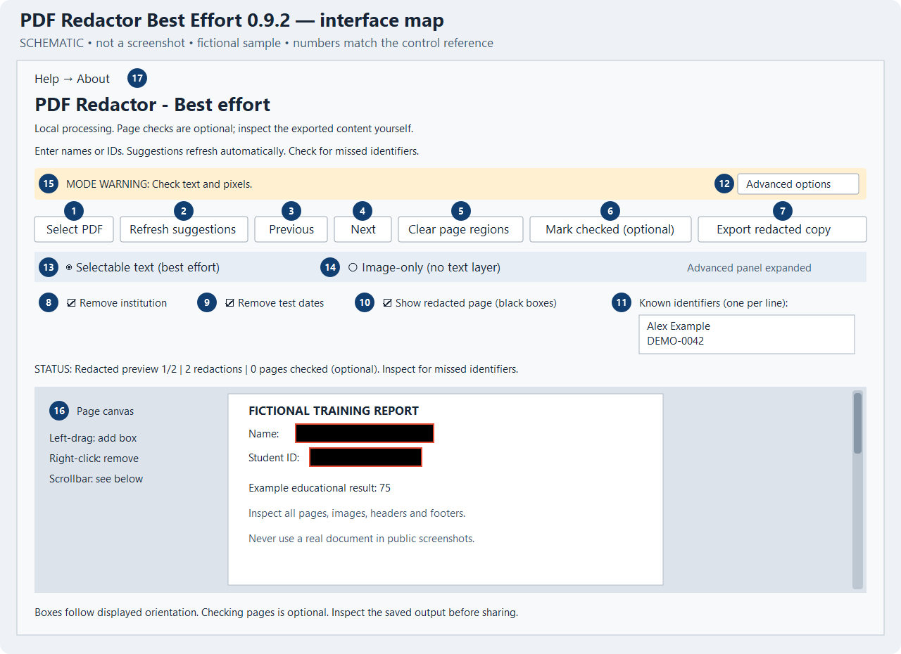
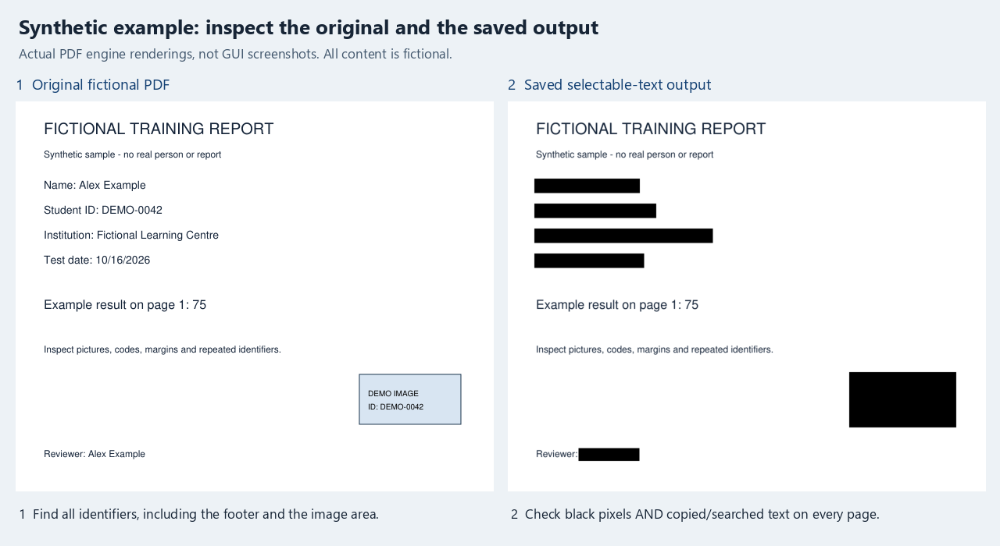

# PDF Redactor Best Effort: user guide

[Back to README](../README.md) · [Download v0.9.2 evaluation](https://github.com/TarronKay/pdf-redactor-best-effort/releases/tag/v0.9.2-evaluation)

This guide covers the Windows **0.9.2 evaluation** interface. It is for someone opening a PDF, selecting information to remove, and saving a separate copy. The application processes PDFs locally, without cloud OCR or uploads.

**An export is not proof of anonymity.** Automatic suggestions can miss identifiers. Selectable text can retain hidden, white, clipped, occluded, misplaced or unselected identifying text. Image-only output removes the searchable text layer but can still show identifying information in the pixels. Inspect every exported page and, for selectable text, the searchable/copied text before sharing.

## Contents

- [Before you begin](#before-you-begin)
- [Interface map](#interface-map)
- [Make your first redacted copy](#make-your-first-redacted-copy)
- [Every control](#every-control)
- [Suggestions and manual boxes](#suggestions-and-manual-boxes)
- [Choose an output mode](#choose-an-output-mode)
- [Files you receive](#files-you-receive)
- [Verify before sharing](#verify-before-sharing)
- [Common problems](#common-problems)
- [Version and illustration notes](#version-and-illustration-notes)

## Before you begin

Use Windows 10/11 x64. The release is an **unsigned evaluation candidate**, provided without warranty. Obtain the MSI from the versioned release above and follow your organization's software rules. This guide does not establish that installation, repair or removal has been validated on your computer. Do not bypass security warnings to use it.

Keep the original in a safe location and choose a separate destination for the exported copy. A local processing app does not prevent a cloud-synced destination folder from syncing your files.

Inputs must be PDFs, at most **20 MiB**, with **1–30 pages**. A password-protected PDF that requires a password must first be replaced with an unlocked copy you are authorized to use. Large page dimensions, rendering budgets, extracted-word counts and processing time limits can reject a file even within the byte/page limits.

Scans, handwriting, outlined letters, QR codes, barcodes, logos and text embedded in pictures require visual inspection and manual boxes. **No OCR is performed.** Report-layout recognition and sample-image warnings are advisory, including on recognized NBME-style reports; no affiliation or endorsement is claimed.

## Interface map



*Source-based schematic of the 0.9.2 controls, not a screenshot. Numbers correspond to the table below. The page content is fictional. Window appearance and wrapping depend on display settings.*

### A fictional example, before and after



*These are real renderings of a two-page synthetic PDF and its exported first page, not GUI screenshots. Automatic suggestions and an added manual region were used. Both output modes were checked on both pages; only selectable-text output is pictured. This small example demonstrates the workflow, not reliable identifier detection on other documents.*

## Make your first redacted copy

1. **Select PDF.** Open a PDF and wait for preparation and the page preview. The first page appears with suggested redactions. Names/IDs left in the identifier field and the current suggestion options also apply when you select another file; check those settings each time.
2. **Enter known identifiers, one per line.** Include names, IDs and other exact strings you want removed. Suggestions refresh automatically after a short pause (about 0.4 seconds). Matching ignores letter case, but does not infer every spelling, spacing, accent or encoding variant. Look for variants manually.
3. **Inspect each page.** Start with **Show redacted page (black boxes)** enabled, the default. Untick it to inspect the original page under colored selection overlays. Use **Previous**, **Next**, and the vertical scrollbar to inspect all content, including page edges and footers.
4. **Correct the selected regions.** Left-drag a rectangle around missed identifiers; leave a small margin. Right-click inside a selected region to remove it, then redraw if needed. There are no resize handles or undo button. Wait for the refreshed preview after each change.
5. **Choose an output mode.** Open **Advanced options**. Selectable text is the default; image-only avoids a reconstructed searchable layer. Review again after changing mode. See [the mode comparison](#choose-an-output-mode).
6. **Optionally mark each page checked.** With the current redacted preview visible, use **Mark checked (optional)** as a progress marker, then **Next**. This does not advance the page, inspect it for you, or enable an anonymity guarantee. Export does not require any pages to be marked.
7. **Export redacted copy.** Choose a `.pdf` filename and destination. Wait for the status message naming the PDF and JSON report actually saved. If a name is already used, the app chooses a free numbered pair rather than overwriting it.
8. **Open that exact exported PDF separately.** Follow [Verify before sharing](#verify-before-sharing). If anything identifying remains, return to the app, add/correct the boxes, export again, and inspect the new numbered output. Share only the inspected copy.

## Every control

| Map | Control | What it does and what to watch for |
| --- | --- | --- |
| 1 | **Select PDF** | Opens a file picker. Selecting a file resets the page, selected boxes and checked-page markers. It keeps current known identifiers, suggestion settings and output mode. Cancel leaves the current document alone. |
| 2 | **Refresh suggestions** | Immediately requests another analysis using current identifiers and settings. Existing boxes are preserved and new suggestions are added. It is not a reset or a removal command. |
| 3 | **Previous** | Moves one page back, stopping at the first page. Navigation does not mark a page checked. |
| 4 | **Next / Last page** | Moves one page forward. At the last page its label becomes **Last page** and the button is disabled. It does not mark pages checked. |
| 5 | **Clear page regions** | Removes **all** currently selected boxes on the displayed page, including suggestions and manual boxes. Other pages are unchanged. There is no confirmation or undo; review carefully and redraw. A later suggestion refresh can add suggestions back. |
| 6 | **Mark checked (optional)** | Records your check of the displayed page for the current redactions/settings/mode. Requires a successful current redacted preview and no pending analysis. It does not move to the next page. Changes can invalidate markers; always recheck affected content. |
| 7 | **Export redacted copy** | Processes the whole document with all current boxes and the selected mode, runs output integrity checks, then writes a new PDF/report pair. It is paused during preparation and pending identifier updates. Unchecked pages do not block export. Canceling the save dialog saves nothing. |
| 8 | **Remove institution** | Enables heuristic institution suggestions, including certain institution-labeled or code-containing header lines. Enabled by default. It does not recognize every institution name or remove an entire institution's identity automatically. Unticking does not delete existing boxes. |
| 9 | **Remove test dates** | Enables suggestions for labeled test/exam/administration dates and matching numeric dates, including history dates. Enabled by default. It can suggest dates you intended to keep and miss other formats. Unticking does not delete existing boxes. |
| 10 | **Show redacted page (black boxes)** | Switches the canvas between the current redacted preview and the original page with colored selection overlays. Enabled by default. Switching views does not add/remove selections or change the export mode. The original view cannot be marked checked. |
| 11 | **Known identifiers (one per line)** | A multiline field for literal names/IDs/strings, ignoring blank lines and leading/trailing whitespace. Changes automatically refresh suggestions. Terms over 200 characters are unsupported by the matching path. Removing a term does not remove boxes it already suggested. |
| 12 | **Advanced options** | Shows/hides the two output-mode radio buttons. Hiding this panel keeps the selected mode. The mode warning near the top remains visible. |
| 13 | **Selectable text (best effort)** | Default. Adds a new invisible searchable text layer over rendered page pixels, omitting words whose extracted boxes intersect selected redactions. Text reconstruction is limited and may retain hidden/unselected identifiers; inspect copied and searched text. |
| 14 | **Image-only (no text layer)** | Writes rendered redacted page images with no extractable text layer. Search, text copying and screen-reader access to page text are lost. Visible identifiers and machine-readable codes outside the boxes remain possible. |
| 15 | **Mode warning and status message** | The mode warning describes text/pixel risks. Status reports local processing, preview page/count, total redactions, optional checked count, advisory warnings, errors, or actual saved filenames and location. Read it after each operation. A redaction count covers the document, not just the visible page. |
| 16 | **Page canvas and vertical scrollbar** | Left-drag to add a rectangle; right-click inside a region to remove the most recently added overlapping region. Scroll to see lower content. Boxes follow displayed page orientation. Page changes/preview refreshes reset the scroll position to the top. No dedicated zoom, rotate, page-jump, batch-export or OCR control is provided. |
| 17 | **Help → About** | In the release launcher, shows version, evaluation/license information, local-processing reminder and where to find matching source and third-party terms beside the app. Close the dialog to continue. |
| — | **Window close (X)** | Closes the application. There is no saveable redaction project/session or unsaved-work prompt. Export and verify your output before closing; reopen the original to start over. |

Buttons and settings may be disabled while processing. The identifier field remains editable; an edit can trigger another analysis and invalidate earlier preview state. Wait until updates settle before continuing.

## Suggestions and manual boxes

Suggestions look for selected kinds of native PDF text: identifier labels such as `Name:` or `Student ID:`, email/phone patterns, long numeric identifiers, optional dates/institution patterns, and your supplied terms. Recognized layouts can add identifier-block suggestions. A suggestion can cover an entire line, including information you wanted to keep. Inspect the selected extent before exporting.

**Suggestion refreshes add to the existing selection.** If you erase `Alex Example` from the identifier field, a box already covering that name stays selected. Likewise, removing a suggested box and later refreshing may add it back. To reduce a selection, right-click unwanted boxes, or clear the current page and redraw. Reopening the PDF resets all boxes but also discards manual work and checked markers.

The original-page view displays colored overlays so you can see the underlying content. The redacted view displays blacked-out page pixels with red outlines around selected regions. Neither view proves every identifier was found. Add manual boxes on **every** page where necessary. Tiny drags of two PDF points or less in either dimension are ignored.

Do not treat a recognized layout, an absence of warnings, or a high box count as evidence that a document is safe. For unfamiliar layouts and image-based pages, review manually from edge to edge. If suggestions are incomplete, the app can still allow manual redaction and export.

## Choose an output mode

| | Selectable text (best effort) | Image-only (no text layer) |
| --- | --- | --- |
| Visible page | Rendered pixels with selected areas blacked out | Rendered pixels with selected areas blacked out |
| Search/copy | New invisible text layer, based on eligible extracted printable ASCII words | No extractable page text |
| Main limitation | Hidden/occluded, misplaced or missed identifying text may remain searchable. Non-ASCII or otherwise ineligible words may be omitted; order/alignment may be imperfect. | Identifiers may remain visible or readable by external OCR/barcode tools wherever you did not select a box. |
| Required inspection | All visible pages **and** copied/searched output text | All visible pages, pictures, codes and other identifying features |

Both modes create a fresh PDF rather than copying original PDF objects. Source metadata, attachments, annotation/form/action objects, bookmarks, source IDs and previous PDF revisions are not carried across. **Visible annotation and form appearances become page pixels**, so identifying content in those appearances still needs a box. Interactive forms, comments, links and bookmarks do not survive as their original interactive objects.

In selectable mode, an extracted word touching a selected rectangle is omitted as a whole from the reconstructed layer; partial-word selection can therefore remove more searchable text than the visible box suggests. This is not a guarantee that other hidden text is absent. Image-only is useful when you do not need selectable text, but neither mode determines whether a document is anonymous or suitable to share.

## Files you receive

For a destination named `redacted-copy.pdf`, a successful export normally creates:

```text
redacted-copy.pdf
redacted-copy.verification.json
```

If either filename exists, the app tries `redacted-copy-1.pdf` and `redacted-copy-1.verification.json`, then the next free number. It preserves the source and existing outputs. Check the status for the **actual** names; an older exported copy does not update when you edit boxes.

The JSON report records the mode (`best-effort-text` or `best-effort-raster`), input/output SHA-256 hashes, page count, box count, optional checked-page count, integrity checks, text diagnostics, word counts and a content warning. It records the number of supplied identifier terms, not their literal values or the source pathname. Hashes still identify particular file contents; keep the report with your own review records and consider whether you need to share it at all.

The report's status is:

```text
BEST_EFFORT_EXPORTED_INTEGRITY_CHECKS_PASSED_CHECK_CONTENT
```

This means the engine's required output integrity checks passed, including checks on the generated object graph and selected black pixels. It does **not** mean all sensitive information was selected. `mandatory_review` is `false`; `pages_marked_checked` is a user progress count. The `text_diagnostics` entries (extractor agreement and text-box alignment) are diagnostic and are **not mandatory pass gates** for selectable-text export. Read the content warning and inspect the PDF regardless of these values.

## Verify before sharing

1. Open the exact newly saved filename in a separate PDF viewer. Compare its page count and visible content with the source. Inspect **every page**, including lower sections, headers, footers, margins, pictures, tables, logos, QR/barcodes and annotation/form appearances.
2. Check that each intended redaction is completely black, with enough margin, and that useful content has not been unnecessarily covered. Look for names, IDs, dates, institution clues and combinations of details that could still identify someone.
3. For **selectable text**, search for each known identifier and likely variants. Select/copy the text from every output page into a local plain-text editor and inspect it for remaining identifiers, including text that was not visibly readable. A failed search alone does not prove absence, especially with encoding or layout differences.
4. For **image-only**, confirm that page text is not selectable/searchable and still inspect all visible pixels. External OCR or barcode readers may read identifiers that remain visible. Do not upload sensitive output to an online checker as part of this workflow.
5. If any check is uncertain, correct the selections or choose another suitable redaction process, then repeat export and inspection. Follow your organization's disclosure rules and review requirements before sharing.
6. Check the filename and destination too: a revealing filename is not redacted. Send only the reviewed exported PDF, rather than the original or an earlier numbered output. The app does not send files or contact recipients.

The app's preview is a working aid. Your final check must use the **saved output**, not only the on-screen preview or JSON report.

## Common problems

| What you see | What to do |
| --- | --- |
| **Cannot open PDF / PDF exceeds 20 MiB / 1 to 30 pages** | Check the file type, size and page count. Use an authorized smaller/split PDF if appropriate, then inspect every resulting part. |
| **This PDF needs a password** | Obtain an unlocked copy through an authorized process. There is no password-entry control in this app. |
| **Little or no searchable text / no OCR / unrecognized layout or images** | Treat suggestions as incomplete. Manually inspect images, handwriting and codes and draw missing boxes. These warnings do not certify content or necessarily block Best Effort export. |
| **Automatic suggestions were incomplete** | Manually review every page. Long/unsupported terms or difficult PDFs can defeat automatic analysis. Do not assume only the visibly missing suggestions failed. |
| Boxes remain after deleting a term or unticking a setting | Existing boxes are deliberately retained. Remove unwanted regions manually; refresh can suggest them again. |
| A desired box disappears after right-click | A right-click removes the newest region containing that point. There is no undo. Redraw and inspect the refreshed page. |
| **Mark checked** is disabled | Wait for current preparation/preview; enable **Show redacted page**. A failed or stale preview cannot be marked checked. Marking is optional and unrelated to whether all identifiers were found. |
| **Export** is disabled / updates are paused | Wait for processing and pending identifier updates to finish. Read the status if preparation fails. Export does not require checked-page markers. |
| **Preview unavailable** | Read the reason. Export can still be attempted in Best Effort and runs its own integrity checks. If you export, carefully inspect the saved PDF separately; do not treat the missing preview as a completed review. |
| **Source changed / settings changed / output differs from current preview** | Select the intended source again if requested, or refresh/review current settings and export again. A stale export is not saved as the current result. |
| **Worker failed / local resource bounds / exceeded 60 seconds** | Processing is bounded for size, memory, CPU and time. Try a simpler/smaller authorized input. Repeating a failing operation does not establish a usable export. |
| **Installed processing worker is missing** | The release requires its companion worker. Use your normal approved repair/reinstallation process; do not copy an unknown worker into the application folder. |
| **Output integrity verification failed; nothing was saved** | Do not rely on an earlier output with the same intended name. Retry only after addressing the input/settings issue; use another suitable process if it persists. |
| **Export failed / choose a .pdf destination / access error** | Choose a writable destination with a `.pdf` suffix, adequate space and a suitable filename. Confirm that a fresh PDF/report pair was actually saved. |
| Search/copy misses useful text, or it looks out of order | Selectable text reconstruction is best effort and limited to eligible words. It is not OCR or faithful native-PDF reconstruction. Inspect the visual page and copied text; choose another process if you require higher text fidelity/accessibility. |

## Version and illustration notes

Control labels and behavior were checked against the public source at release tag [v0.9.2-evaluation](https://github.com/TarronKay/pdf-redactor-best-effort/tree/v0.9.2-evaluation), commit `93e41b2e4ba1b7b1415ff437209e826202a36ab6`: [GUI entry point](../app/release_gui.py), [Best Effort app](../app/best_effort_app.py), [workflow](../app/ui_workflow.py), [canvas controls](../app/ui_base.py), [output engine](../app/best_effort_engine.py), and [file naming](../app/export_files.py).

The interface map is a documentation schematic, with fictional content only; its [editable SVG source](images/interface-map.svg) is included. The PDF example uses generated fictional content only. No real reports, owner documents, system paths or screenshots of other applications are included.

Documentation checks exercised the actual source GUI with its window kept withdrawn: file preparation and previews, control labels/defaults, additive refresh, optional checking and invalidation, original/redacted views, navigation, clear-page behavior, advanced-panel and mode changes, drawing/right-click removal, and PDF/report export. Synthetic two-page exports passed required engine integrity checks in both modes, with zero pages marked checked; extracted fixture names/IDs were absent and image-only output had no extractable text. This is limited source-level testing with the available PyMuPDF 1.28.0 runtime, not testing of the frozen 1.28.2 release or installer. Native GUI screenshots and interactive desktop validation were unavailable in the documentation environment; the figures are explicitly labeled accordingly.

This version has two Best Effort modes; legacy strict hybrid/native reconstruction options and their guarantees are excluded. See [README](../README.md), [building instructions](../BUILDING.md) and [licensing](../LICENSING.md) for release context.
